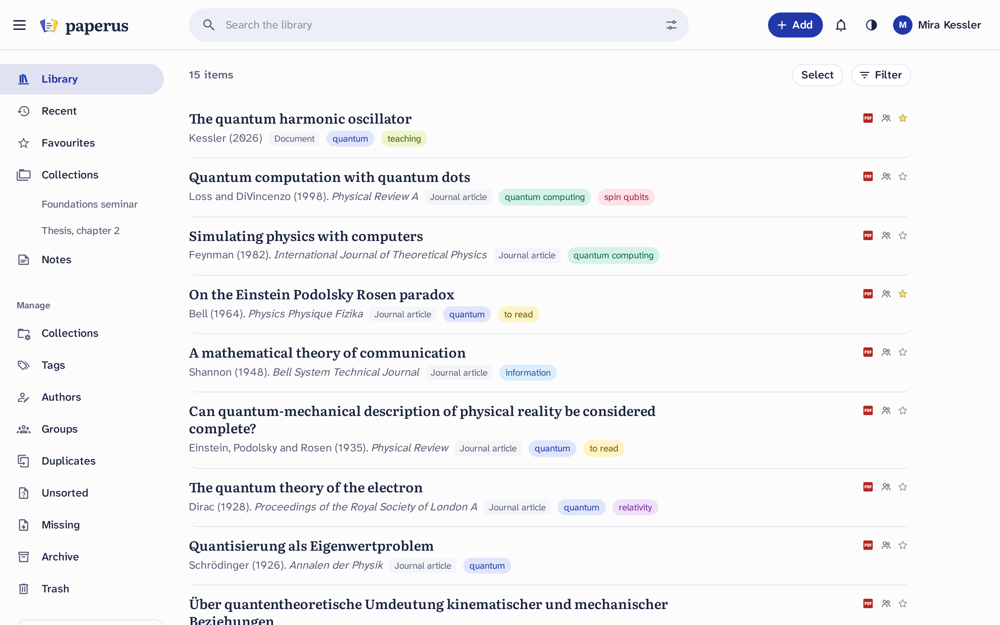

<h1>
  <picture>
    <source media="(prefers-color-scheme: dark)" srcset="docs/logo/paperus-logo-dark.svg">
    
  </picture>
</h1>

[](https://github.com/qcode-uni-a/paperus/actions/workflows/ci.yml)
[](https://github.com/qcode-uni-a/paperus/releases/latest)
[](LICENSE)
[](https://pypi.org/project/paperus/)
[](https://www.npmjs.com/package/paperus)
[](https://github.com/qcode-uni-a/paperus/pkgs/container/paperus-server)
[](https://addons.mozilla.org/firefox/addon/paperus/)
[](https://qcode-uni-a.github.io/paperus/demo/)

*Papers, for us.* A research library for groups, on your own server, read
with the AI assistant you already use. Made by scientists, for scientists.

**[Homepage](https://qcode-uni-a.github.io/paperus/)** and
**[demo](https://qcode-uni-a.github.io/paperus/demo/)** (a recorded library to
look around in: uploads, changes and search by meaning don't work there).

<picture>
  <source media="(prefers-color-scheme: dark)" srcset="site/screenshots/library-dark.png">
  
</picture>

> Status: beta (0.0.21), in a pilot. It works, with private papers and
> nested groups, but the data format may still change. See the
> [changelog](CHANGELOG.md) for what is there and what is missing.

## The idea

- **AI first, on your terms**: no built-in chatbot and no AI vendor. Any
  assistant (Claude, ChatGPT, a self-hosted or local model) connects through
  an MCP server, sees only what the user may see, cites the exact passage
  and asks before it changes anything. paperus finds, checks and keeps
  track; the assistant does the thinking.
- **One library for the group**, on your own server with your organisation's
  login (OIDC), groups inside groups, plus private space for each member.
- **Search by meaning** across the full text of every paper, note and
  annotation, computed on the server with a small open model.
- **PDFs that fit your phone**: fluent mode turns two columns into one,
  figures whole, highlights and notes as on the page.
- **Preprints that get published**: the published version is found by
  itself, and cited from then on.
- **Apps for Linux, Windows and macOS**: your libraries in a window of their
  own, notifications, PDFs added with "Open with" (Linux, macOS); installers on each
  [release](https://github.com/qcode-uni-a/paperus/releases). Android and iOS
  are planned.
- **Sources first**: papers, lecture notes, meeting notes and their versions,
  with notes and annotations attached to them. Not a general notes app.
- **No lock-in**: full export of files, BibTeX/CSL-JSON, Markdown notes and
  annotations at any time.
- **And the rest**: import, export, OCR, tags, collections, smart collections,
  annotations, notes, duplicates, open-access PDFs, authors with ORCID,
  references and cited-by, similar papers, browser extension, backups,
  monitoring.
- **Free and open source, forever**: Apache-2.0, no paid tier, no account
  with us; your server, your data.

## Installation

Needs a Linux machine with Docker and about 4 GB of RAM (the model for search
by meaning takes 2–3 GB).

1. Download [`deploy/compose.yaml`](deploy/compose.yaml) and
   [`deploy/example.env`](deploy/example.env) into a new folder; rename
   `example.env` to `.env`.
2. In `.env`, set the folders for files, database, backups and models
   (`CONTACT_EMAIL`, which metadata services ask for, can also be given
   later under Administration → Settings → Server). Random secrets for
   `DB_PASSWORD` and `ML_TOKEN` in one go:
   ```sh
   sed -i "s/^DB_PASSWORD=.*/DB_PASSWORD=$(openssl rand -hex 16)/; s/^ML_TOKEN=.*/ML_TOKEN=$(openssl rand -hex 32)/" .env
   ```
3. Put a reverse proxy with HTTPS in front of port 8000, on a (sub)domain of its
   own; examples for Caddy and nginx are in
   [operations](docs/operations.md#reverse-proxy).
4. Start: `docker compose up -d`. The first start downloads the model (about
   2.3 GB).
5. Open paperus in the browser: create the administrator account, or restore
   a backup found in the backup folder (for moving to a new server). The
   library page then lists the first steps: backups, adding people, the
   browser extension, connecting an AI assistant.

Just trying it out, without HTTPS? Open `http://localhost:8000` on the same
machine; from another computer on the network, set `COOKIE_SECURE=false` in
`.env` first (the login cookie is otherwise sent over HTTPS only).

Backups of the database run every night from the start; add the files (the
PDFs), or change when, under Administration → Backups. They go into
`BACKUP_LOCATION` on another disk; restoring is described in
[operations](docs/operations.md#backups). To update, change `PAPERUS_VERSION`
or pull `release` again, then `docker compose up -d`.

**Browser extension** (Chrome, Firefox): one click saves the paper you are
reading, with its PDF, or the PDF you have open; right-click it to save to
another owner; on arXiv, a button next to each paper. For Firefox on
[addons.mozilla.org](https://addons.mozilla.org/firefox/addon/paperus/); for
Chrome and Edge, until it is in their store, load it from the release's zips:
see [extension/README.md](extension/README.md).

## Documents

| Document | Contents |
| --- | --- |
| [Architecture](docs/architecture.md) | Components, stack, data model, scaling |
| [Ingestion](docs/ingestion.md) | Adding items, metadata, PDFs, browser extension, versions, other sources |
| [Export](docs/export.md) | Taking everything home: a SQLite database and the files, in zips; importing it back |
| [Search](docs/search.md) | Chunking, embeddings, hybrid search, deduplication across versions, pgvector |
| [Permissions](docs/permissions.md) | Who may do what with papers, tags, collections and groups |
| [AI integration](docs/ai.md) | MCP tools, permissions, the AI inbox, skill draft |
| [Apps](docs/apps.md) | One app for computers and phones (begun), a library on one's computer, offline sync |
| [Operations](docs/operations.md) | Hosting at the university, data protection, lessons from similar projects |
| [Decisions](docs/decisions.md) | Decisions made so far and open questions |
| [Pilot](docs/pilot.md) | Pilot plan and questions for testers |

Planned work, ideas and bugs are in the [issues](https://github.com/qcode-uni-a/paperus/issues);
labels show the area and whether a point still needs discussion.

## Development

Needs Docker, [uv](https://docs.astral.sh/uv/) and Node.js.

```sh
docker compose up -d                       # Postgres with pgvector on localhost
cd server
uv run alembic upgrade head
uv run paperus user create alice --admin   # asks for a password
uv run paperus serve --reload              # API on http://localhost:8000
uv run paperus worker                      # background jobs, in a second terminal

cd ml                                      # machine learning service (search by meaning)
PAPERUS_ML_CACHE_PATH=../data/model-cache uv run paperus-ml
# or in a container, with the same model folder:
# docker compose --profile ml up -d

cd web
npm install
npm run dev                                # website on http://localhost:5173
npm run api                                # after API changes: regenerate the client
```

To try it from a phone on the same network: start the API with
`PAPERUS_COOKIE_SECURE=false` (plain HTTP outside localhost) and the website
with `npm run dev -- --host 0.0.0.0`, then open `http://<this PC's IP>:5173`.

`npm run build` writes the website to `web/build`, which `paperus serve`
serves on its own port as well. Checks: `uv run pytest`, `uvx pre-commit run --all-files`.

The app for computers (Tauri, Rust) is in `app/` ([app/README.md](app/README.md));
its installers for Linux, Windows and macOS are on each
[release](https://github.com/qcode-uni-a/paperus/releases). The homepage is in
`site/`, its demo in `e2e/demo/` ([README](e2e/demo/README.md)).

## Licence

Apache-2.0, see [LICENSE](LICENSE). Bundled fonts and libraries keep their
own licences, see [THIRD_PARTY.md](THIRD_PARTY.md).
